[![Badge Release]][Releases]
[![Badge License]][License file]
[![Badge Issues]][Issues]
[![Badge Stars]][Stargazers]
[![Badge Last commit]][Commits]
[![Badge Manifest]][Manifest file]
[![Badge Edge]][Edge Add-ons]

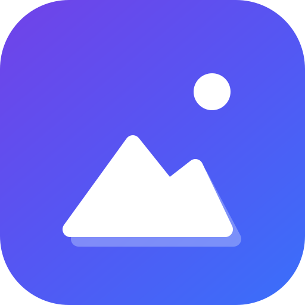

<h1 align="center">ImgFetch</h1>

Free image downloader and screenshot extension for Chrome and Edge. Bulk download images, save image as PNG, JPG or WebP, and take full page screenshots. No accounts, no tracking.

<a href="#install">Install</a> ·
<a href="#features">Features</a> ·
<a href="#documentation">Docs</a> ·
<a href="CHANGELOG.md">Changelog</a> ·
<a href="https://github.com/umr-x/ImgFetch/issues">Issues</a>

Applies to: ImgFetch 1.1.0
Last verified: 2026-10-22

**Version 1.1.0**, released on GitHub Releases on 2026-10-22 (tag `v1.1.0`). Version 1.0.0 was released on 2026-10-12.

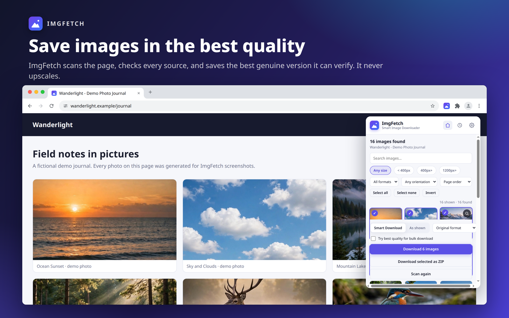

## Install

| Browser                                                                                            | Install from                                                                 | Status                                                                                                                                |
| -------------------------------------------------------------------------------------------------- | ---------------------------------------------------------------------------- | ------------------------------------------------------------------------------------------------------------------------------------- |
|  | [Edge Add-ons][Edge Add-ons]                                                 | Published. Version 1.1.0 is live.                                                                                                     |
|   | [Latest release on GitHub](https://github.com/umr-x/ImgFetch/releases/latest) | Chrome Web Store listing coming soon. For now, download the ZIP from the latest GitHub release and install it unpacked (steps below). |
|         | Firefox Add-ons                                                              | Coming soon (needs a separate port)                                                                                                   |
|                   | [GitHub Releases][Releases]                                                  | Latest: 1.1.0, ZIP download for Chrome                                                                                                |

### Install in Chrome

The Chrome Web Store listing is coming soon. Until then, install ImgFetch in Chrome from the release file:

1. Download the ZIP from the [latest GitHub release][Latest release] and unzip it. The unzipped folder must contain `manifest.json` at the top level.
2. Open `chrome://extensions` in Chrome.
3. Turn on **Developer mode** (top right corner).
4. Click **Load unpacked** and select the unzipped folder. You can also drag the unzipped folder onto the page.
5. Pin ImgFetch from the extensions menu if you want it on the toolbar.

Chrome may show a developer mode notice for extensions installed this way, and it does not update them automatically. To update, download the newest release and repeat these steps.

### Install in Edge

You can install the official extension directly from the Microsoft Edge Add-ons store.
*Note: The current live listing serves version **1.1.0**.*

### For developers

You can also clone the repository with `git clone https://github.com/umr-x/ImgFetch` and load the cloned folder with **Load unpacked** the same way.

## Contents

- [Install](#install)
- [Features](#features)
- [See it in action](#see-it-in-action)
- [Quick start](#quick-start)
- [Keyboard shortcuts](#keyboard-shortcuts)
- [Privacy and permissions](#privacy-and-permissions)
- [Supported browsers and languages](#supported-browsers-and-languages)
- [Documentation](#documentation)
- [Contributing](#contributing)
- [Security](#security)
- [Translations](#translations)
- [Release history](#release-history)
- [FAQ](#faq)
- [License](#license)
- [About](#about)

## Features

ImgFetch is a free, open-source image downloader and screenshot extension for Google Chrome and Microsoft Edge.
It finds the real sources behind a page image, checks that each source loads, and saves the best valid one.
It never upscales an image and never claims quality it has not verified.

| Area                   | What it does                                                                                                                                                                                        |
| ---------------------- | --------------------------------------------------------------------------------------------------------------------------------------------------------------------------------------------------- |
| Image downloads        | Right-click Smart Download saves the best validated source. It never upscales and never invents a better source.                                                                                    |
| Whole page scan        | Scan This Page finds all images across a whole page for preview, filtering and bulk image download.                                                                                                 |
| Bulk and ZIP           | Download a selection one by one, or pack it into a single ZIP file.                                                                                                                                 |
| Formats and conversion | Save image as PNG, JPG, WebP, AVIF, GIF, SVG or BMP (for example WebP to PNG or JPG) where the browser supports the format. Quality settings apply per format, and PNG at full quality is lossless. |
| Screenshots            | Take a full page screenshot (scrolling capture), or capture the Visible area, a selected Area or a single Element. Long pages are split into balanced parts and reviewed in the Parts overview.     |
| Editor                 | Annotate screenshots with Pen, Arrow, Rectangle, Circle, Text and Pixelate, adjust the frame with the non-destructive Crop tool, then use Undo, Redo, Copy and Save.                                |
| Languages              | The interface is available in 21 locales covering 19 languages, with a right-to-left layout for Arabic.                                                                                             |
| Privacy                | Everything runs on your device. There are no accounts, no analytics, no telemetry and no tracking.                                                                                                  |

## See it in action

|                                                                                                                                                                                                                                                  |                                                                                                                                                                                           |
| ------------------------------------------------------------------------------------------------------------------------------------------------------------------------------------------------------------------------------------------------ | ----------------------------------------------------------------------------------------------------------------------------------------------------------------------------------------- |
| 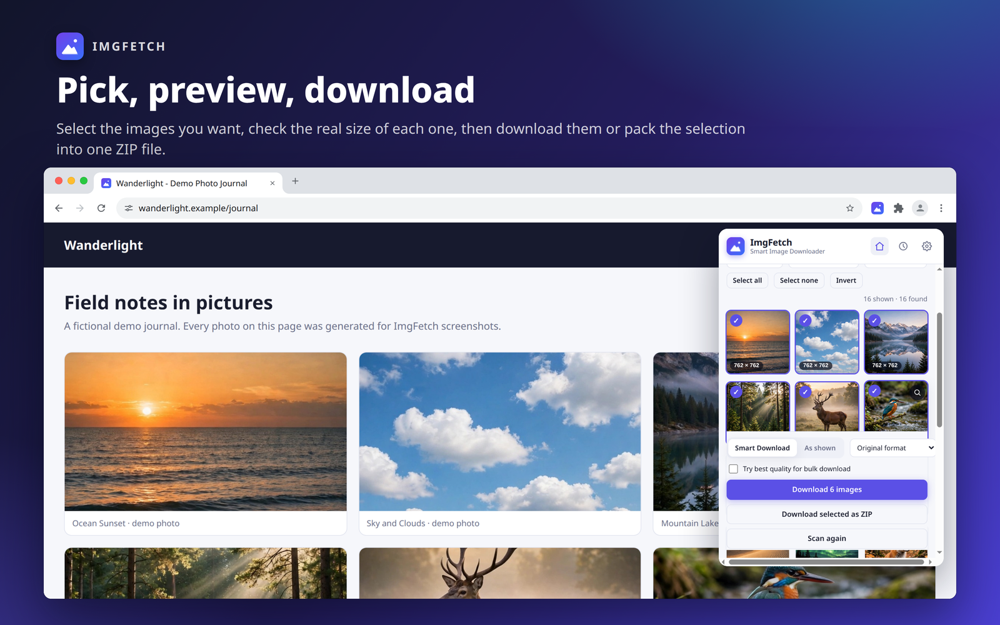Select images from the scan results and download them, one by one or as a ZIP.                                                     | 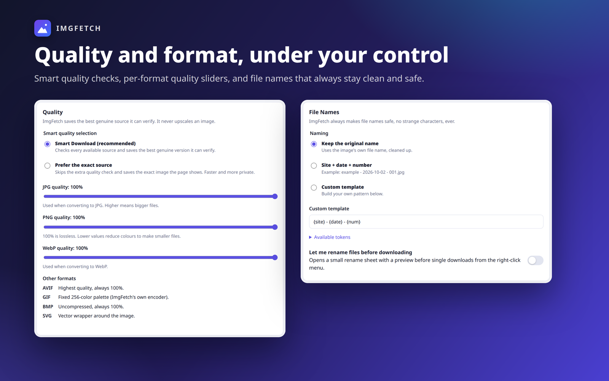Quality, format and file name options for saved images.                                        |
| 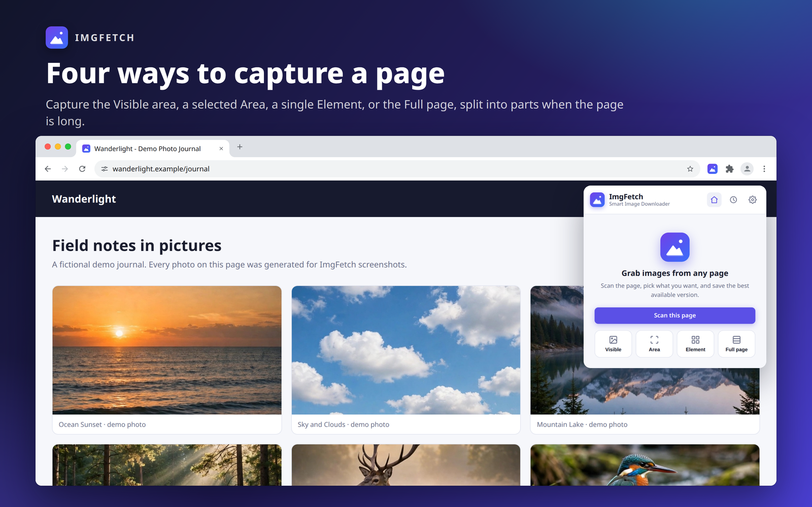Four screenshot modes: Visible, Area, Element and Full page.                                                                  | 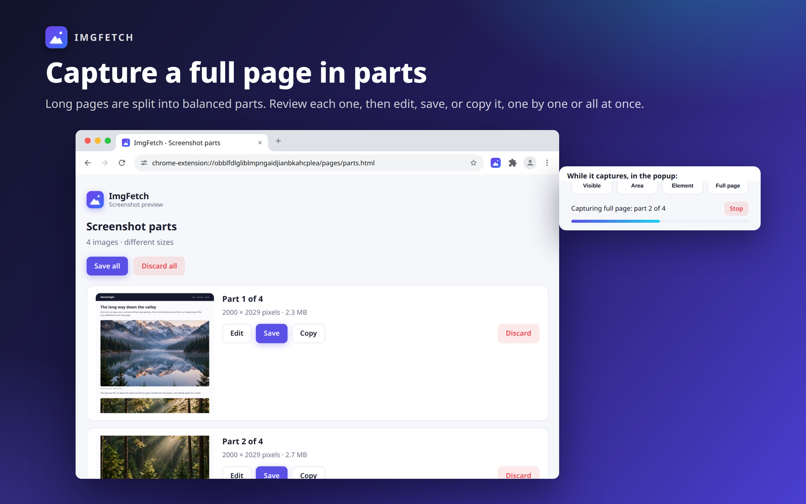A long full page capture split into parts, reviewed in the Parts overview. |
| 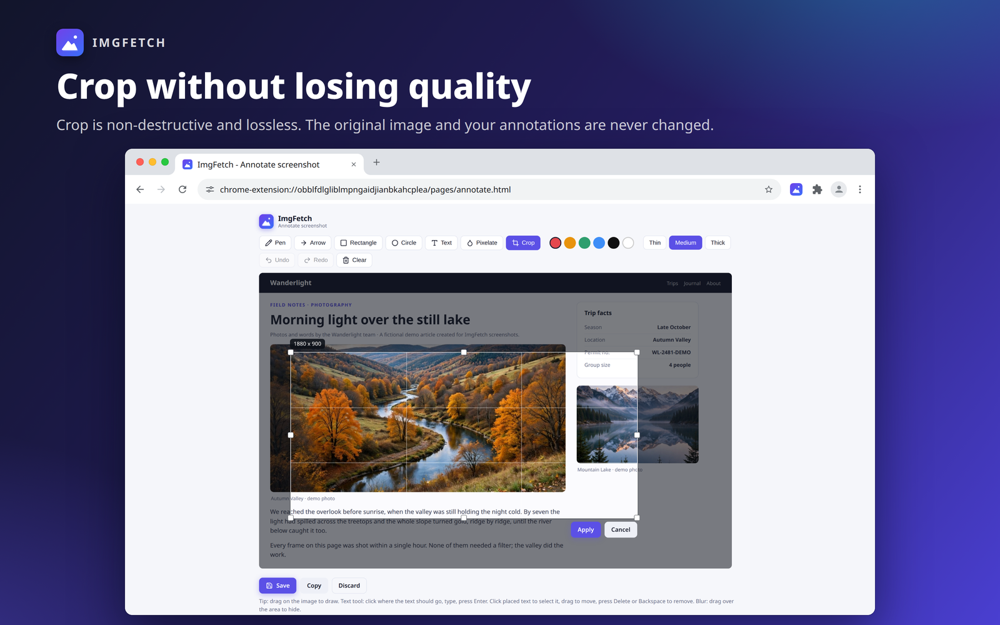The editor with the non-destructive Crop tool active.                                                                            | 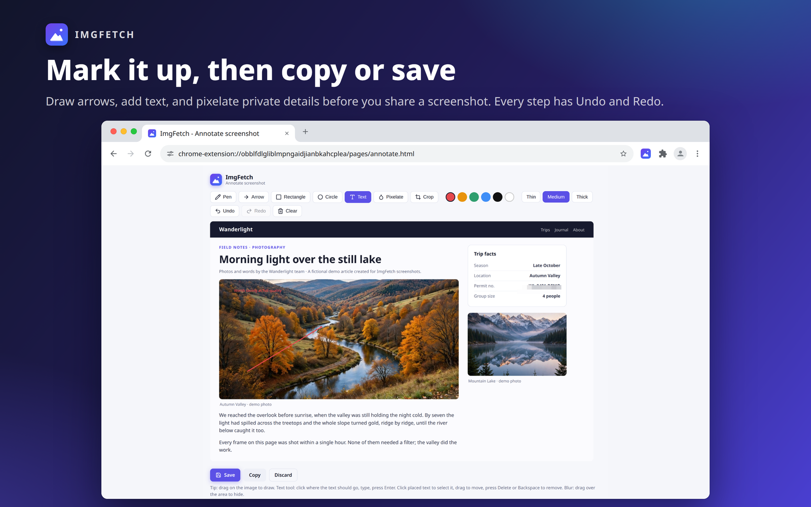Annotate a capture, then Copy or Save it.           |
| 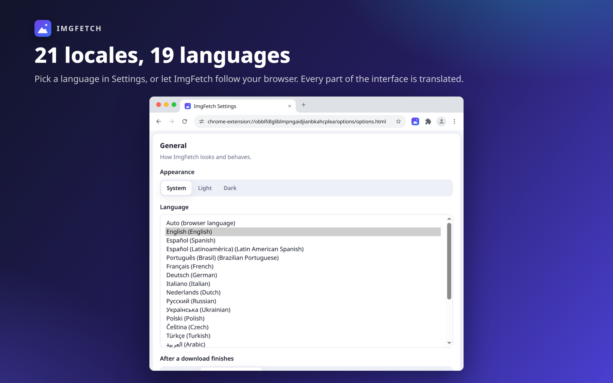Settings with the language picker: 21 locales covering 19 languages.                                                            | 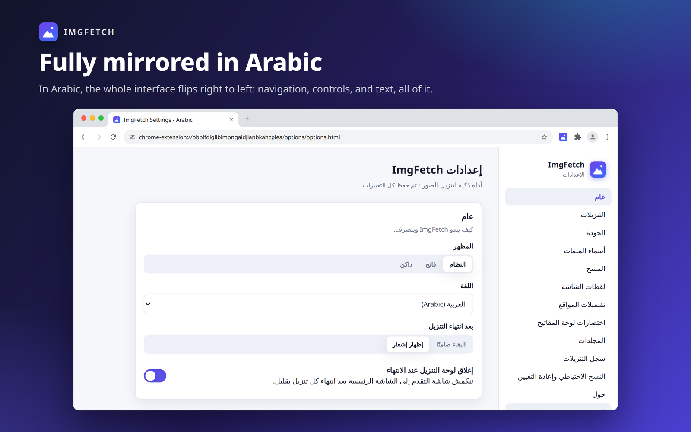Arabic uses a full right-to-left layout.                                                         |
| 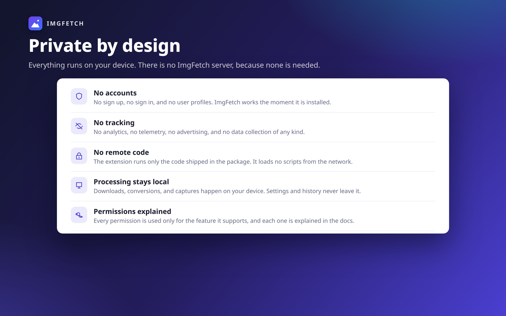Private by design: no accounts, no tracking, no remote code. |                                                                                                                                                                                           |

## Quick start

1. Open a page with images and click the ImgFetch toolbar button to scan the page.
2. Preview the results, filter if needed, and download one image or a selection.
3. Or right-click any image and choose **Smart Download** to save its best source at once.
4. Use the popup screenshot buttons to capture the Visible area, an Area, an Element or the Full page.
5. Annotate or Crop the screenshot in the editor, then choose Save or Copy.

## Keyboard shortcuts

Defaults come from the extension manifest.
You can change them at `chrome://extensions/shortcuts` in Chrome or `edge://extensions/shortcuts` in Edge.
On macOS, use Command instead of Ctrl for the extension shortcuts.

| Command                 | Default key    | Action                                                                       |
| ----------------------- | -------------- | ---------------------------------------------------------------------------- |
| Scan page               | Ctrl+Shift+S   | Scan the page for images                                                     |
| Scan page (alternative) | No default key | Scan the page for images; bind your own key in the browser shortcut settings |
| Capture area            | Ctrl+Shift+X   | Capture a selected Area                                                      |
| Capture element         | Ctrl+Shift+E   | Capture a single Element                                                     |
| Select element          | Alt+Shift+E    | Pick an Element and show its image details                                   |

Editor shortcuts, active in the screenshot editor:

| Shortcut                            | Action                                                        |
| ----------------------------------- | ------------------------------------------------------------- |
| C                                   | Select the Crop tool                                          |
| Ctrl+Z (Cmd+Z on macOS)             | Undo                                                          |
| Ctrl+Y                              | Redo                                                          |
| Ctrl+Shift+Z (Cmd+Shift+Z on macOS) | Redo                                                          |
| Enter                               | Apply a pending crop, or confirm a Text label                 |
| Esc                                 | Cancel a pending crop or a Text label                         |
| Arrow keys                          | Nudge a pending crop by 1 pixel (Shift+arrow keys: 10 pixels) |
| Delete or Backspace                 | Delete the selected Text label                                |

Undo does exactly what the Undo button does, including the crop step in the same history, and it does not fire while you type in the text annotation box, where the browser native text undo keeps working.

## Privacy and permissions

The full policy is in [PRIVACY.md](PRIVACY.md), and [docs/permissions.md](docs/permissions.md) explains each permission.

- No accounts: ImgFetch has no sign up, no sign in and no user profiles.
- No tracking: there is no analytics, no telemetry, no advertising and no data collection of any kind.
- No remote code: the extension runs only the code shipped in the package and loads no scripts from the network.
- Permissions are used only for the feature they support, such as downloads for saving files, scripting for scanning pages and clipboardWrite for the Copy actions; [docs/permissions.md](docs/permissions.md) lists each one.
- Your data stays on your device: settings, download history and captures are stored locally in your browser and are never sent anywhere by ImgFetch.

## Supported browsers and languages

| Browser                 | Support                                                                                   |
| ----------------------- | ----------------------------------------------------------------------------------------- |
| Google Chrome           | Supported; requires Chrome 116 or later                                                   |
| Microsoft Edge          | Supported; Chromium based Edge                                                            |
| Other Chromium browsers | Not officially tested; the extension may load and work                                    |
| Firefox                 | No Firefox version exists yet; a Firefox version is coming soon and needs a separate port |

The interface is available in 21 locales covering 19 languages: English, Spanish, Latin American Spanish, Brazilian Portuguese, French, German, Italian, Dutch, Russian, Ukrainian, Polish, Czech, Turkish, Arabic, Simplified Chinese, Traditional Chinese, Japanese, Korean, Indonesian, Vietnamese and Thai.
Change it under Options, General, Language; the default is Auto, which follows the browser language.
Arabic uses a right-to-left layout.
Translations are AI assisted and have not been reviewed by native speakers; corrections are welcome through an issue or [docs/translating.md](docs/translating.md).

## Documentation

Root documents:

- [CHANGELOG.md](CHANGELOG.md): what changed in each version.
- [CONTRIBUTING.md](CONTRIBUTING.md): how to set up, test and submit changes.
- [SECURITY.md](SECURITY.md): how to report a vulnerability.
- [CODE_OF_CONDUCT.md](CODE_OF_CONDUCT.md): the standard expected in project spaces.
- [PRIVACY.md](PRIVACY.md): the full privacy policy.
- [TERMS.md](TERMS.md): terms of use.

Guides and references in `docs/`:

- [docs/README.md](docs/README.md): the documentation index with reading paths.
- [docs/user-guide.md](docs/user-guide.md): task based guide for every feature.
- [docs/architecture.md](docs/architecture.md): components, messages, storage and design.
- [docs/project-structure.md](docs/project-structure.md): annotated file tree and naming rules.
- [docs/permissions.md](docs/permissions.md): every permission, why it exists and what happens without it.
- [docs/security-model.md](docs/security-model.md): threat model and mitigations.
- [docs/limitations.md](docs/limitations.md): known limits, reasons and workarounds.
- [docs/performance.md](docs/performance.md): measured performance and design notes.
- [docs/build.md](docs/build.md): how to build, check and package the extension.
- [docs/translating.md](docs/translating.md): how translations are organized and how to add one.
- [docs/glossary.md](docs/glossary.md): short definitions of terms used in the code and docs.
- [docs/tests/README.md](docs/tests/README.md): test suites, how to run them and what they cover.
- [docs/tests/manual-test-checklist.md](docs/tests/manual-test-checklist.md): checks that need a human and a real browser.
- [docs/decisions/README.md](docs/decisions/README.md): index of architecture decision records.
- [docs/history/README.md](docs/history/README.md): index of historical build records.
- [store-assets/store-listing.md](store-assets/store-listing.md): store listing text and the pre-submission checklist.

The code is split by role: `background/` holds the service worker, `content/` holds the page scanner and overlay, `core/` holds pure logic modules, `offscreen/` holds the hidden document used for conversion and stitching, and `popup/`, `options/` and `pages/` hold the user interface.
Shared interface code lives in `shared/`, tests in `tests/` and build tooling in `scripts/`.
The full annotated tree is in [docs/project-structure.md](docs/project-structure.md).

## Contributing

Contributions are welcome; start with [CONTRIBUTING.md](CONTRIBUTING.md) and open an issue before large changes so the approach can be agreed first.
Run the test suites and `scripts/validate.py` before opening a pull request.
Project spaces follow the [Code of Conduct](CODE_OF_CONDUCT.md).

## Security

To report a security problem, follow [SECURITY.md](SECURITY.md) and use GitHub private vulnerability reporting rather than a public issue.

## Translations

Translations live in `_locales/`, one folder per locale. See [docs/translating.md](docs/translating.md) for how to add or fix a language, and run `node scripts/check-i18n.mjs` before submitting.

## Release history

- **1.1.0, 2026-10-22:** the current release. See [CHANGELOG.md](CHANGELOG.md) for what changed and [GitHub Releases][Releases] for the downloads.
- **1.0.0, 2026-10-12:** the first public release.

## FAQ

**1. Is ImgFetch free?** 
Yes. ImgFetch is free software under the GNU General Public License v3 or later, with no paid tier and no accounts.

**2. Does it upload my images anywhere?** 
No. Downloads, conversions and captures happen on your device.
The only network requests are the ones needed to fetch images you chose to save.

**3. Why is the Chrome Web Store listing coming soon?** 
The Chrome Web Store listing is not live yet; until it is, install 1.1.0 from GitHub Releases as described under [Install](#install).

**4. Why is AVIF sometimes unavailable?** 
AVIF encoding depends on the browser, and ImgFetch offers it only when a real encode test succeeds.
On older browsers it shows a clear message instead of silently saving a different format.

**5. Why does a copied screenshot not appear in Windows clipboard history?** 
On Windows, clipboard history (Win+V) does not show images above roughly 4 MB.
The copy still worked: paste it with Ctrl+V into Paint, a document or a chat.
ImgFetch shows a short note in the editor for large images on Windows, and a longer copy toast for very large copies, so this limit does not look like a failed copy.

**6. What happens when a full page is too long for one screenshot?** 
The capture is split into balanced parts, each up to 32767 pixels per side and about 100 megapixels, stored on your device.
When the capture finishes, one Parts overview page opens where you can review each part and Edit, Save, Copy or Discard it, or Save all parts at once.
Parts already finished are kept if you stop the capture or switch tabs.

**7. How does Crop work in the editor?** 
Crop is non-destructive: the original image and your annotations are never modified, and the crop rectangle is stored alongside them in the same Undo and Redo history.
Drag the rectangle, resize it with its 8 handles, nudge it with the arrow keys, then apply it with Enter.
Save and Copy export exactly the cropped region at full quality.

## License

ImgFetch is free software: you can redistribute it and modify it under the terms of the GNU General Public License as published by the Free Software Foundation, either version 3 of the License, or (at your option) any later version.
See [LICENSE](LICENSE) for the full text.

The GPL covers the source code. It does not grant the right to use the ImgFetch name or logo as branding for a modified version. See [TRADEMARK.md](TRADEMARK.md).

Official sources: this repository, its [GitHub Releases][Releases] and the [Microsoft Edge Add-ons][Edge Add-ons] listing. A copy that uses the ImgFetch name from anywhere else is not official.

## About

ImgFetch is free and open source software with no accounts, no tracking and all processing on your device. Copyright (C) 2026 ImgFetch Developer.

<!--------------------------------------------------------------------------->

<!--------------------------------- Stores ---------------------------------->

<!--------------------------------- Project --------------------------------->

[Badge Release]: https://img.shields.io/github/v/release/umr-x/ImgFetch
[Badge License]: https://img.shields.io/badge/License-GPLv3-blue.svg
[Badge Issues]: https://img.shields.io/github/issues/umr-x/ImgFetch
[Badge Stars]: https://img.shields.io/github/stars/umr-x/ImgFetch
[Badge Last commit]: https://img.shields.io/github/last-commit/umr-x/ImgFetch
[Badge Manifest]: https://img.shields.io/badge/Manifest-V3-blue
[Badge Edge]: https://img.shields.io/badge/Edge_Add--ons-available-0078D7?logo=microsoftedge&logoColor=white
[Edge Add-ons]: https://microsoftedge.microsoft.com/addons/detail/obblfdlgliblmpngaidjianbkahcplea
[Releases]: https://github.com/umr-x/ImgFetch/releases
[Latest release]: https://github.com/umr-x/ImgFetch/releases/latest
[License file]: LICENSE
[Manifest file]: manifest.json
[Issues]: https://github.com/umr-x/ImgFetch/issues
[Stargazers]: https://github.com/umr-x/ImgFetch/stargazers
[Commits]: https://github.com/umr-x/ImgFetch/commits/main
