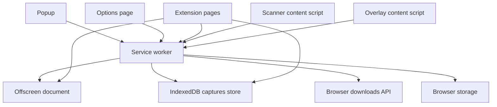
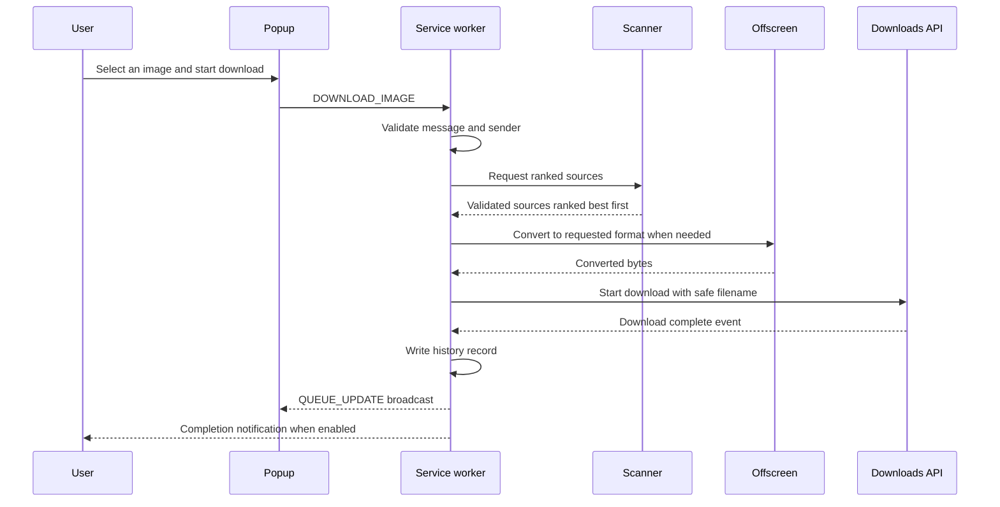
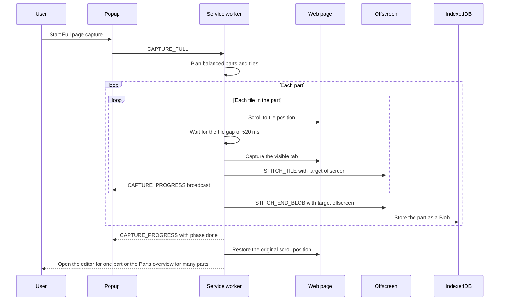
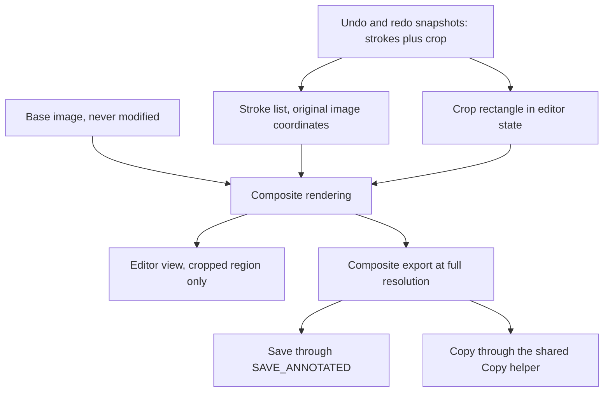

# ImgFetch Architecture

How ImgFetch is structured, how its parts communicate, and where each responsibility lives.

Applies to: ImgFetch 1.1.0
Last verified: 2026-10-22

## Purpose and scope

This document describes the architecture of the ImgFetch extension as shipped in version 1.1.0.
It covers the runtime components, the message protocol, storage, security boundaries, and performance design.
It does not cover usage instructions, which live in [the user guide](user-guide.md).
Permission justifications live in [the permissions document](permissions.md).

## System context

ImgFetch is a Manifest V3 browser extension for Google Chrome and Microsoft Edge.
It runs entirely on the user device and needs no account, no server, and no network service of its own.
The only network activity is fetching image bytes and page resources that the user asked to save or convert.
The browser supplies the platform APIs: downloads, storage, scripting, context menus, notifications, and tab capture.
Web pages are untrusted input: the extension reads image data from them but never executes page code in its own context.

Design principles:

1. Pure core, thin edges. Decision logic lives in `core/` as functions with no `chrome.*` dependency, so Node unit tests can run it directly.
2. Validate, then route. Every runtime message is checked in `core/validation.js` before the service worker acts on it.
3. Fail closed. Unknown message types, unknown senders, and malformed payloads are denied, never guessed at.
4. No remote code and no build step. The extension ships plain JavaScript, HTML, and CSS that load unpacked without tooling.

## Component overview

| Component | Path | Responsibility |
|---|---|---|
| Service worker | `background/service-worker.js` | Context menus, message routing, download queue, screenshots, history writes, offscreen lifecycle |
| IndexedDB helper | `background/idb.js` | Promise based wrapper over the `imgfetch` IndexedDB database and its `captures` store |
| Content script, scanner | `content/scanner.js` | Collects page images, probes candidate sources, ranks them, reports scan progress |
| Content script, overlay | `content/overlay.js` | Full screen Area selector and Element picker, returns device pixel rectangles |
| Offscreen document | `offscreen/offscreen.js`, `offscreen/offscreen.html` | Format conversion, SVG sanitizing, ZIP building, stitching, clipboard writes, Blob handling |
| Popup | `popup/popup.js`, `popup/popup.html` | Scan results, filters, preview, download queue view, history view, capture controls and progress row |
| Options page | `options/options.js`, `options/options.html` | Settings editor with autosave, reached through `options_page` in the manifest |
| Page, Welcome | `pages/welcome.html`, `pages/welcome.js` | First run onboarding |
| Page, Capture | `pages/capture.html`, `pages/capture.js` | Single screenshot preview and save actions |
| Page, Annotate | `pages/annotate.html`, `pages/annotate.js` | Screenshot editor with Pen, Arrow, Rectangle, Circle, Text, Pixelate, and Crop, plus Undo (Ctrl+Z, Cmd+Z on macOS) and Redo (Ctrl+Y, Ctrl+Shift+Z, Cmd+Shift+Z on macOS) |
| Page, Parts overview | `pages/parts.html`, `pages/parts.js` | One card per part of a multi part Full page capture, with Edit, Save, Copy, Discard, Save all, and Discard all |
| Page, Info | `pages/info.html`, `pages/info.js` | Image details and per image actions |
| Page, Rename | `pages/rename.html`, `pages/rename.js` | Ask for filename sheet shown before a save when that setting is on |
| Shared modules | `shared/` | Design system, messaging and theme helpers, localization loader, capture reading, Copy helper, undo stack, platform detection |
| Core modules | `core/` | Pure logic: URLs, filenames, settings, validation, queue, history, capture planning, crop geometry, and format helpers |
| Background helper | `background/idb.js` | See the service worker rows above: this module is the only IndexedDB access point for the worker |

Shared modules in detail:

| Module | Responsibility |
|---|---|
| `shared/ui.css` | Design system with light and dark themes |
| `shared/ui.js` | Theme handling, toast notices, messaging helpers |
| `shared/i18n.js` | Custom localization loader, locale list, fallback and plural rules |
| `shared/capture-io.js` | Reads capture records from IndexedDB for result pages, polls while a record is pending |
| `shared/copy-shot.js` | Copy action for screenshots, async clipboard with a downscale fallback for very large images |
| `shared/undo-redo.js` | Undo and redo stack used by the editor, carries strokes and crop together |
| `shared/platform.js` | Platform detection and the large copy rule behind the Windows clipboard history note |

Core modules in detail:

| Module | Responsibility |
|---|---|
| `core/urls.js` | URL normalization, host rules, private network guard, redirect block check |
| `core/filenames.js` | Safe filename building and traversal proof download paths |
| `core/filters.js` | Search, filter, and sort for scan results |
| `core/settings.js` | Settings schema, defaults, normalization, per site quality mode |
| `core/validation.js` | Message types, sender rules, payload validation, friendly error mapping |
| `core/queue.js` | Download queue with concurrency, retry, and cancel |
| `core/queue-persist.js` | Throttled and immediate queue persistence |
| `core/history.js` | Download history records, pruning, and grouping |
| `core/dedupe.js` | Scan result deduplication |
| `core/exif.js` | EXIF parsing for orientation and GPS |
| `core/export.js` | Format conversion planning and quality resolution |
| `core/gif.js` | Pure JavaScript GIF encoder |
| `core/png-quantize.js` | PNG color reduction used only on the explicit quality path |
| `core/zip.js` | Part based ZIP builder |
| `core/zip-accum.js` | Chunked ZIP accumulator with abort and a two minute time limit |
| `core/fullpage-capture.js` | Full page part planner: balanced parts, tile layout, growth handling |
| `core/capture-decision.js` | Capture mode decision logic for scroll target selection |
| `core/capture-storage.js` | Capture record byte accounting and group aware pruning rules |
| `core/clipboard-image.js` | Copy size planner: full image or downscaled copy |
| `core/crop-image.js` | Lossless in worker crop for Area and Element captures |
| `core/crop-rect.js` | Editor Crop geometry: clamp, resize by handle, nudge, view and image conversion |
| `core/data-url.js` | Chunked data URL decoder that does not fetch data URLs |
| `core/svg.js` | Allowlist based SVG sanitizer |
| `core/bulk-payload.js` | Queue payloads for single and bulk downloads, candidate sanitizing |
| `core/folders.js` | Download folder resolution for the organize modes |
| `core/image-url.js` | Best image URL selection for the Copy Image Link action |
| `core/scan-state.js` | Scan lifecycle state: idle, scanning, results |

## Diagrams

### Component diagram

### Sequence diagram: single image download

### Sequence diagram: Full page capture with parts

### Editor rendering and crop model

The editor keeps three separate layers of state.
The base image is loaded once and is never modified.
Annotations are stored as a stroke list in original image coordinates.
The Crop tool stores one rectangle in editor state, in original image pixels, or no rectangle when no crop is applied.
Rendering draws the base image region inside the crop rectangle, then draws the strokes offset by the crop origin.
Export composes the same two layers onto a fresh canvas at full resolution, so Save and Copy match the cropped view exactly.
Undo and redo snapshots carry both the stroke list and the crop rectangle, so one undo step restores the previous crop state.
The Undo shortcut (Ctrl+Z, or Cmd+Z on macOS) runs the same action as the Undo button and does not fire while typing in the text annotation box. Redo uses Ctrl+Y or Ctrl+Shift+Z (Cmd+Shift+Z on macOS).

## Message protocol

All runtime messages pass through the service worker.
The protocol is defined in `core/validation.js`, which holds the `MESSAGE_TYPES` set and the `SENDER_RULES` map.
There are 39 runtime message types in total, grouped by direction below.

### Pages to service worker

These 33 types come from the popup, the options page, and the extension pages.
Settings: `GET_SETTINGS`, `SAVE_SETTINGS`, `RESET_SETTINGS`, `OPEN_OPTIONS`.
Scanning: `SCAN_PAGE`, `GET_LAST_SCAN`, `GET_SCAN_STATE`.
Downloads and queue: `DOWNLOAD_IMAGE`, `DOWNLOAD_MANY`, `DOWNLOAD_ZIP`, `DOWNLOAD_STRIPPED`, `GET_QUEUE`, `RETRY_QUEUE`, `CANCEL_QUEUE`, `CLEAR_QUEUE`.
History: `GET_HISTORY`, `CLEAR_HISTORY`.
Capture: `CAPTURE_VISIBLE`, `CAPTURE_AREA`, `CAPTURE_ELEMENT`, `CAPTURE_FULL`, `CANCEL_CAPTURE`, `GET_CAPTURE_PROGRESS`.
Capture records: `SAVE_CAPTURE`, `DISCARD_CAPTURE`, `DISCARD_CAPTURE_GROUP`, `SAVE_ANNOTATED`, `GET_CAPTURE`.
Helpers: `SUGGEST_FILENAME`, `GET_IMAGE_INFO`, `GET_FORMAT_SUPPORT`, `RESOLVE_BLOB`, `SHOW_DOWNLOAD`.

### Content scripts to service worker

One type: `SCAN_PROGRESS`, sent by the scanner while a scan runs.
It is the only type a content script may send.

### Service worker broadcasts

These five types are broadcast to extension pages and are not requests: `QUEUE_UPDATE`, `SCAN_DONE`, `NOTICE`, `NOTICE_TEXT`, `CAPTURE_PROGRESS`.
`CAPTURE_PROGRESS` carries the part number, part total, tile number, tile total, and a phase of capturing, done, stopped, or error.
The popup renders it as one live status row and can request the current value at any time with `GET_CAPTURE_PROGRESS`.

### Sender rules

`SENDER_RULES` in `core/validation.js` maps each routable type to the sender kinds allowed to send it.
The sender kind is derived from the sender URL: extension pages have a `chrome-extension://` URL, content scripts run inside a tab, and anything else is unknown.
Only `SCAN_PROGRESS` allows the content kind.
Every other routable type allows the extension kind only.
Unknown senders are denied for every type, and broadcast types have no inbound route except `CAPTURE_PROGRESS`, which the popup may also receive under the extension rule.

### Validation and size caps

`isValidMessage` in `core/validation.js` rejects a message when the envelope is not a plain object, when the type is not in `MESSAGE_TYPES`, or when a declared string field holds a non string value.
It also checks the serialized size of the whole message.
The cap is 45,000,000 characters for `SAVE_ANNOTATED`, because annotated screenshots travel as data URLs, and 1,000,000 characters for every other type.
The service worker applies one further cap on the annotated save path: a `dataUrl` longer than 40,000,000 characters is rejected as too large.
`CAPTURE_PROGRESS` payloads get extra checks: the phase must be a known value and all four counts must be integers within bounds, with no counter above its total.
Capture record and group identifiers are accepted only when they match the shape the worker mints, so foreign identifiers never reach the storage layer.

### Offscreen messages

The offscreen document uses its own channel: messages carry `target` set to `offscreen` and are handled by the switch in `offscreen/offscreen.js`.
There are 22 offscreen types.
Conversion: `CONVERT_IMAGE`, `CONVERT_BMP`, `CONVERT_SVG`, `CONVERT_GIF`, `STRIP_METADATA`, `SNIFF_TYPE`, `SANITIZE_SVG`, `SUPPORTS_AVIF`.
ZIP: `BUILD_ZIP`, `ZIP_ABORT`, `REVOKE_URL`.
Clipboard: `CLIPBOARD_WRITE`, `CLIPBOARD_IMAGE`.
Stitching: `STITCH_BEGIN`, `STITCH_TILE`, `STITCH_END`, `STITCH_END_BLOB`, `STITCH_PROBE`, `STITCH_EXTEND`, `STITCH_ABORT`.
Capture groups and diagnostics: `CAPTURE_GROUP_FINALIZE`, `MEMORY_SAMPLE`.

## Storage

| Data | Location | Retention and caps |
|---|---|---|
| Settings | `chrome.storage.local`, key `imgfetch.settings` | Normalized settings object, kept until the user resets or removes the extension |
| Download history | `chrome.storage.local`, key `imgfetch.history` | At most 200 records, pruned by the retention setting, default 30 days, and only when history is enabled |
| File counter | `chrome.storage.local`, key `imgfetch.fileCounter` | Monotonic counter used in generated filenames |
| Onboarding flag | `chrome.storage.local`, key `imgfetch.onboarded` | Set once the Welcome flow has been seen |
| Last scan | `chrome.storage.session`, key `imgfetch.lastScan` | Session scoped cache for the active tab, cleared when the browser session ends |
| Capture records | IndexedDB database `imgfetch`, store `captures` | Expire after 1 hour, at most 60 records, total size cap of 500,000,000 bytes |

Capture pruning follows `core/capture-storage.js` and runs by group.
Records that belong to an open capture group are never pruned.
Closed groups are pruned as a whole, oldest first, when the age, count, or size cap is exceeded.
Full page parts are stored as Blobs written directly from the offscreen document to IndexedDB, never as large base64 strings.
Older records that still carry a `dataUrl` string keep working through the shared helpers in `shared/capture-io.js`.
Settings defaults and the full settings schema are defined in `core/settings.js`.
History record shape and pruning live in `core/history.js`.

## Security boundaries

The full threat model, attacker model, and mitigation list live in [the security model](security-model.md).
In short: page content and image bytes are untrusted, every inbound message is validated and checked against sender rules before routing, and downloads are limited to URLs that pass the URL guard in `core/urls.js`.
Format conversion and SVG handling run in the offscreen document, isolated from extension pages.
The extension loads no remote code, and its content security policy allows scripts and objects from the extension itself only.
User facing failures are reported through the `friendlyError` mapping, which never exposes raw technical errors.

## Performance design notes

The annotation canvas in the editor is allocated lazily, only on the first drawing action, which keeps memory low when a large screenshot is only viewed or cropped.
Full page parts are stored as Blobs in IndexedDB straight from the offscreen document, so no giant base64 string crosses a message boundary or sits in worker memory.
Tiles inside one part are captured with a fixed gap of 520 ms between shots, which respects the browser capture rate limit of about two captures per second.
Stitch work for one tile overlaps the wait for the next tile where the pipeline allows it.
Editor rendering is layered: the base image and the annotation layer are composited per frame instead of repainting one flattened bitmap, and export composes once at full resolution.
Scan probing in the scanner runs with limited concurrency and a per candidate timeout, so a slow page cannot stall a scan.

## Error handling

Validation fails closed: an invalid message, an unlisted sender, or an oversized payload is dropped before routing, and no partial action is taken.
User facing errors use `friendlyError` in `core/validation.js`, which maps internal codes such as `bad-url`, `convert-failed`, `capture-failed`, and `private-network` to short plain language strings.
A translator can be registered with `setErrorTranslator`, so the same mapping serves localized text once localization is ready.
When one download candidate fails, the worker tries the next ranked candidate and reports progress through queue notices instead of failing the whole download.
When a capture fails or is cancelled, finished parts are kept, the page scroll position is restored, and a final `CAPTURE_PROGRESS` broadcast reports the stopped or error phase.

## Extension points

New pure logic belongs in `core/` with unit tests, following the pattern of the existing modules: no `chrome.*` calls, inputs and outputs as plain data.
New message types must be added to `MESSAGE_TYPES`, given string field declarations and a `SENDER_RULES` entry in `core/validation.js`, and handled in the service worker router.
New offscreen operations must be added to the message switch in `offscreen/offscreen.js` and called with `target` set to `offscreen`.
New pages belong in `pages/` and should reuse `shared/ui.css`, `shared/ui.js`, and `shared/i18n.js` instead of adding page local copies.
New settings belong in the schema and defaults in `core/settings.js`, so normalization, the options page, and the contract tests stay in agreement.
The reasoning behind the larger structural choices is recorded in [the decision records](decisions/README.md).
